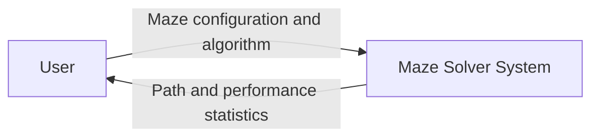
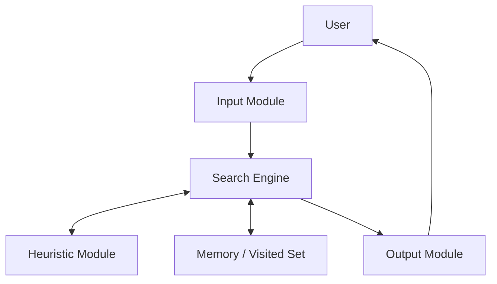
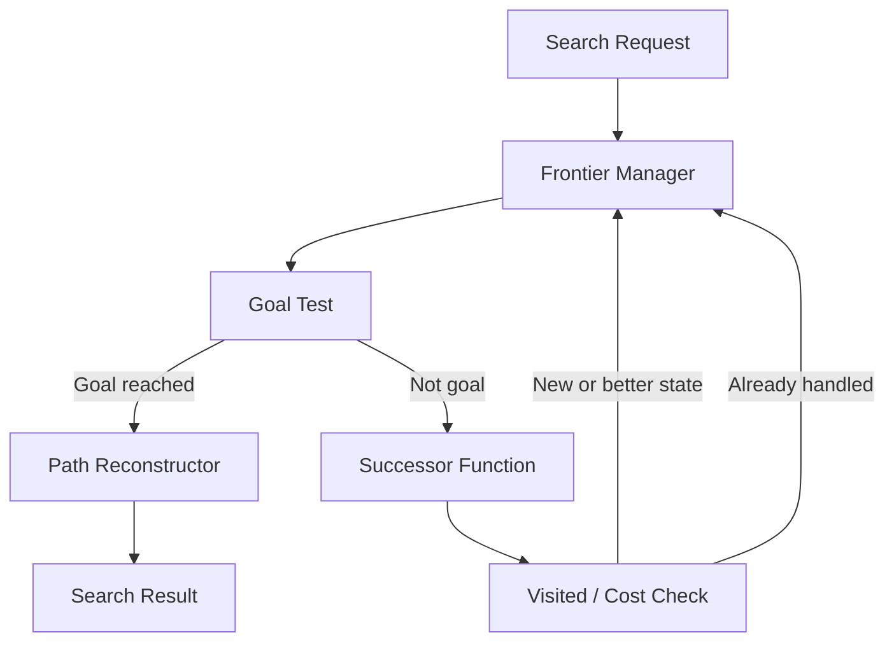

# SLE-3 Architecture — Interactive Maze Solver & Pathfinding System

**Student:** Krisha Champalal Shaha  
**PRN:** 25UAM070 · **Division:** A  
**Course:** 02AML204 – Introduction to Artificial Intelligence

This document translates the four-level C4 description in the SLE-3 report into repository documentation. The implementation is a command-line Python program.

## Level 1 — System Context

The user provides grid dimensions, start and goal coordinates, obstacles, and an algorithm choice. The Maze Solver returns a path (if one exists), path cost, explored-node count, and execution time.

## Level 2 — Containers

- **Input Module:** reads and validates dimensions, coordinates, walls, and algorithm selection. Implemented in `main`, `parse_position`, `parse_walls`, and `MazeProblem.is_valid`.
- **Search Engine:** runs BFS, DFS, or A*. Implemented in `solve_bfs`, `solve_dfs`, `solve_astar`, and `run_search`.
- **Heuristic Module:** calculates Manhattan distance for A*. Implemented in `heuristic`.
- **Memory / Visited Set:** records discovered or explored coordinates and stores parent/cost information. Implemented using `visited`, `closed`, `parent`, and `g_score`.
- **Output Module:** prints the maze, path, cost, nodes explored, and elapsed time. Implemented in `display_maze` and `main`.

## Level 3 — Search Engine Components

- **Frontier Manager:** FIFO queue for BFS, LIFO stack for DFS, and priority queue for A*.
- **Successor Function:** generates valid Up, Down, Left, and Right cells.
- **Goal Test:** checks whether the current coordinate equals the goal.
- **Visited / Cost Check:** avoids duplicate discovery in BFS/DFS; A* tracks best known path costs and closed states.
- **Path Reconstructor:** follows parent pointers from the goal back to the start and reverses the list.

## Level 4 — Code-Level Mapping

| Design element | Implementation |
|---|---|
| Grid / problem data | `MazeProblem` dataclass |
| State / position | `tuple[int, int]` |
| Valid move generation | `MazeProblem.get_neighbors()` |
| Manhattan heuristic | `heuristic()` |
| BFS | `solve_bfs()` |
| DFS | `solve_dfs()` |
| A* | `solve_astar()` |
| Parent-chain path building | `reconstruct_path()` |
| Timing and dispatch | `run_search()` |
| Input and display | `main()`, `display_maze()` |

## Key design decisions

1. **Separate algorithm functions:** each search strategy can be tested and explained independently.
2. **Visited/cost tracking:** BFS and DFS use a set to avoid repeatedly adding the same coordinate. A* stores best known costs and uses a closed set. Set membership is O(1) on average.
3. **Manhattan heuristic:** appropriate for a four-directional grid with unit move costs; it does not overestimate the remaining path length.
4. **Parent pointers:** store the predecessor of each discovered state so the final path can be reconstructed without copying a full path into every frontier entry.

## Limitations and verification

- The interface is command-line based; it does not include graphical animation.
- Each move has cost 1, and diagonal movement is not allowed.
- Execution time varies by machine and maze; use actual runs for any performance claims.
- Run a reachable maze, an unreachable maze, and the same maze with BFS, DFS, and A* before demonstrating the project.
